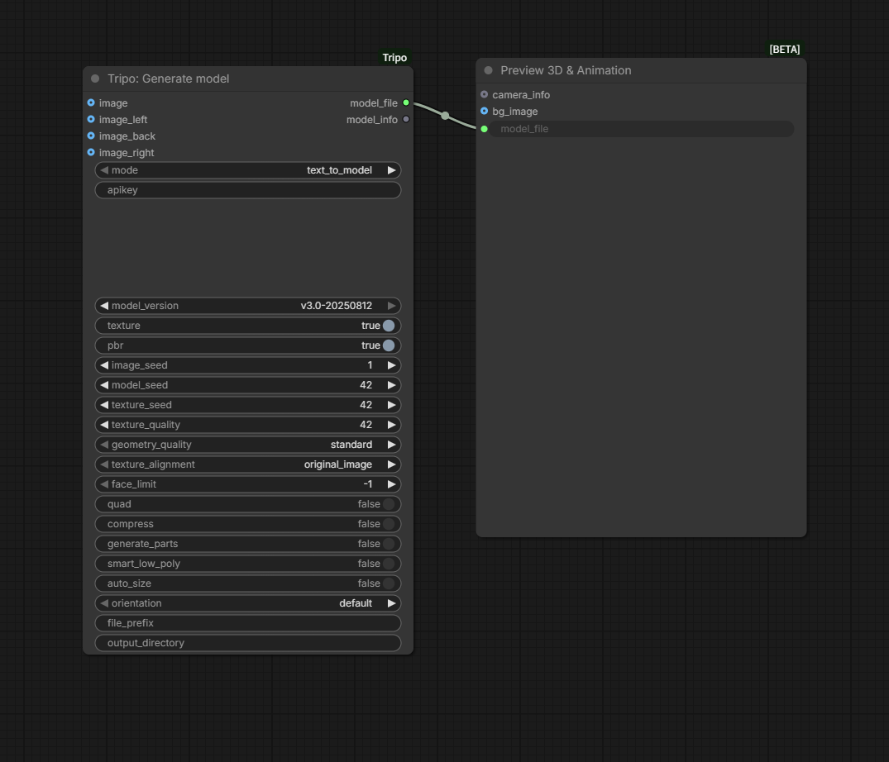
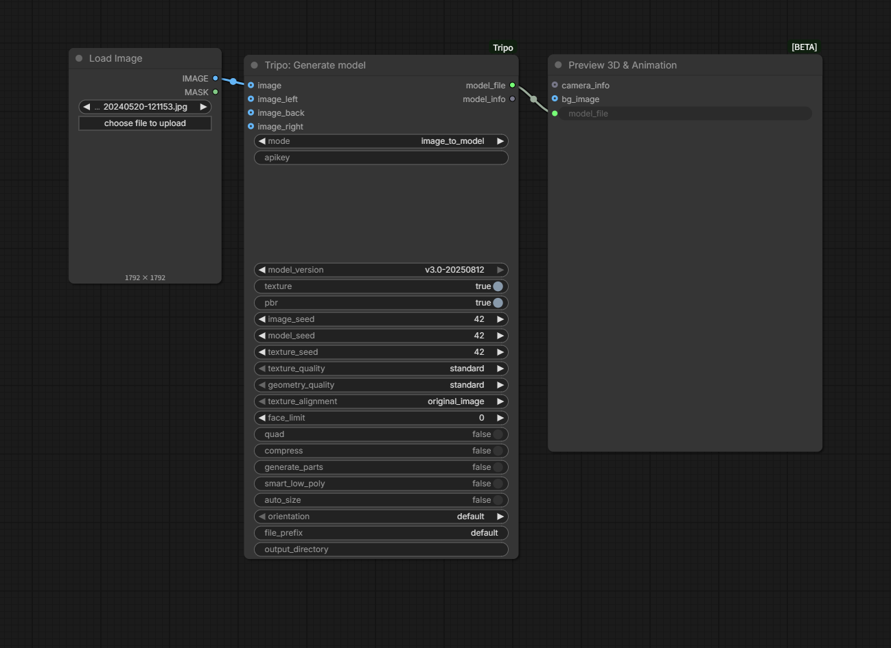
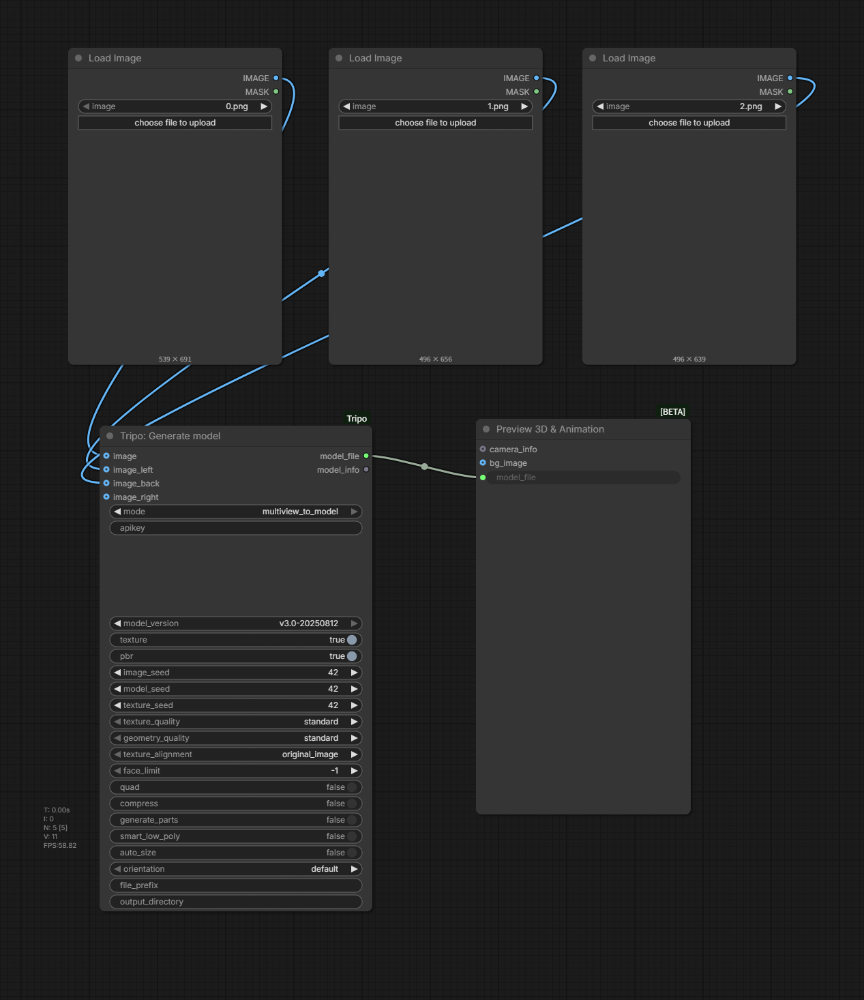
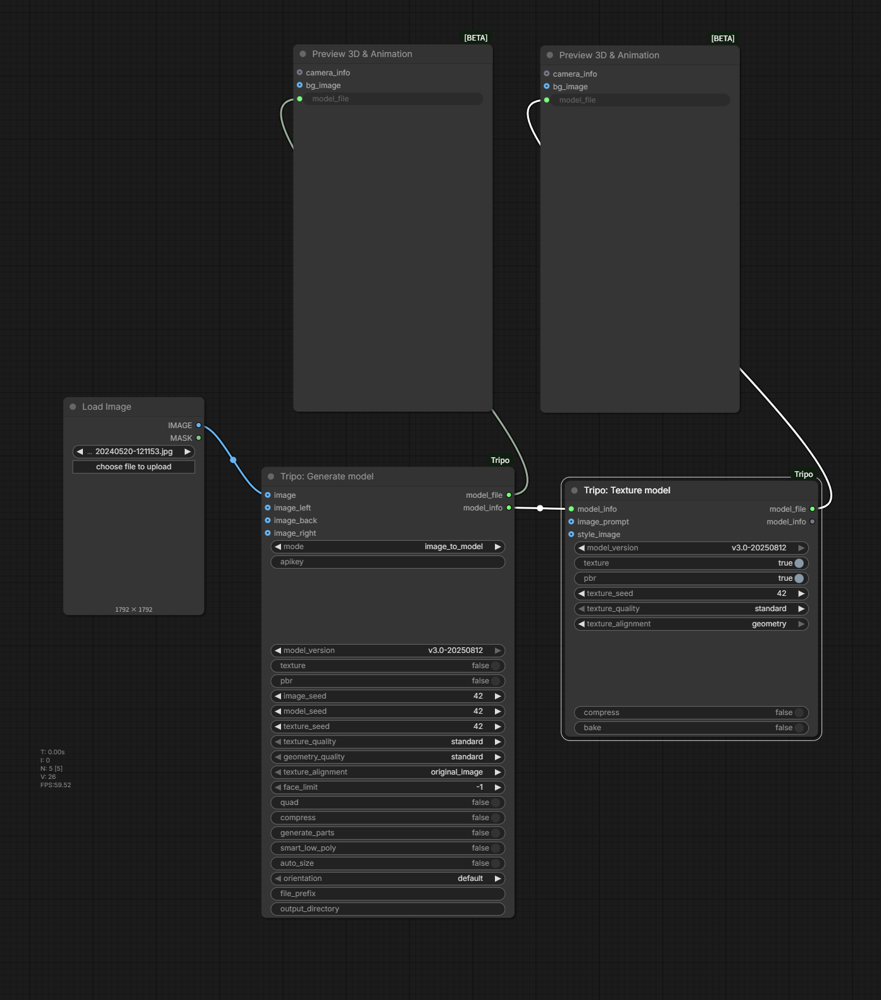
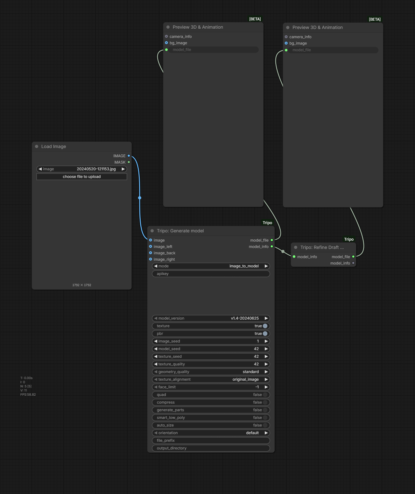
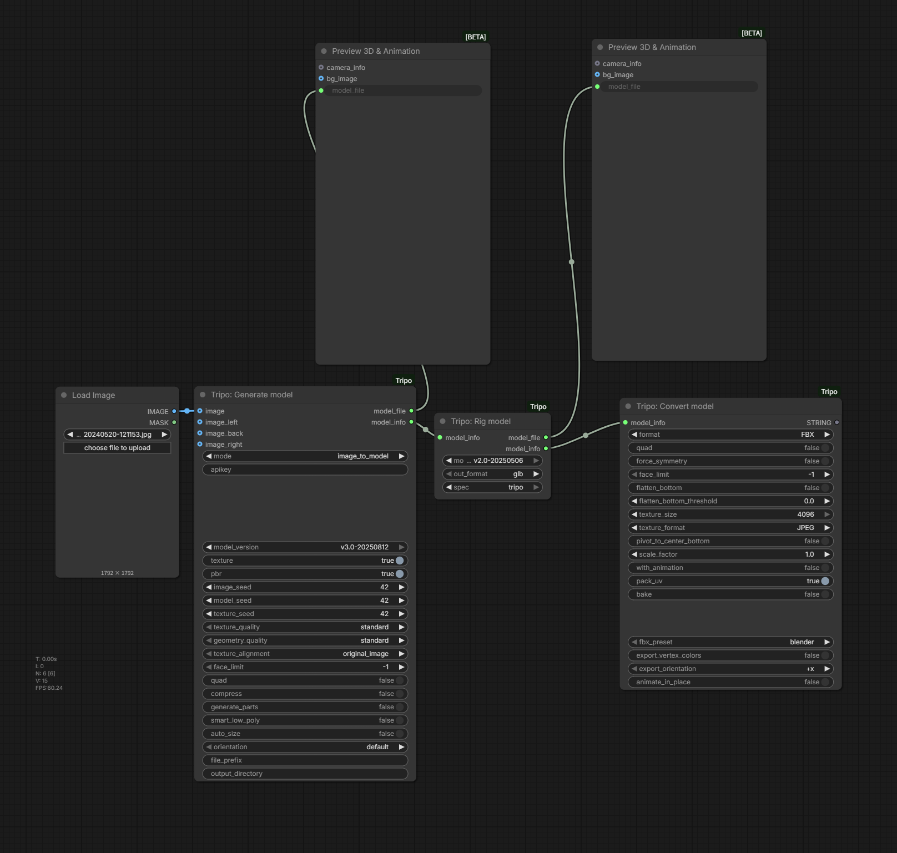

# ComfyUI-Tripo
This extension integrates Tripo into ComfyUI, allowing users to generate 3D models from text prompts or images directly within the ComfyUI interface.

> **2.0.0 runs on Tripo API v3 and requires `tripo3d>=1.0.0,<2.0.0`.** The v2 API is shut down on
> 2026-10-31, so 1.x of this extension (and `tripo3d` 0.x) stop working then. Update the extension and
> run `pip install -r requirements.txt` (ComfyUI-Manager does this for you). Saved workflows keep
> working: no node or input was renamed or removed. **Refine** and **Stylize** are no longer supported by
> Tripo: the nodes are kept as deprecated (hidden from search) so saved workflows still open, but running
> them stops with an explanation — remove them from the workflow.
> See [CHANGELOG.md](CHANGELOG.md).

## ChangeLog
- 20261015: 2.0.0 — migrate to Tripo API v3 (requires `tripo3d>=1.0.0,<2.0.0`); add **Tripo: Smart UV** node; Rig v2.5 / v3.0 and more skeleton specs; texture v3.5 (`fast`, `delight`); smart low poly v3.0 with Smart UV; mesh completion mode; deprecate **Refine** and **Stylize** (no longer supported by Tripo; the nodes stop with an explanation)
- 20260630: support Mesh Segmentation v2.0; support `model_url` for direct URL import
- 20260528: add import model
- 20250619: update to the newest api; add more nodes
- 20250331: use tripo3d package
- 20250224: remove glbviewer
- 20250201: adapt for new api; use preview3D for viewing models
- 20241111: adapt for new api
- 20241014: support convert
- 20240913: support model_version v2.0-20240919

## Features
- Generate 3D models from text prompts
- Generate 3D models from images
- Import models from URL (`model_url`)
- Mesh Segmentation (v1 and v2.0) and mesh completion
- Smart low poly (v2.0 / v3.0) and Smart UV
- Animate 3D models
- Convert format and retopologize

Refine and Stylize are no longer supported by Tripo. Their nodes are deprecated: hidden from the node
search, still loadable in saved workflows, and they stop with an explanation instead of calling the API.

### Smart UV
**Tripo: Smart UV** unwraps a model's UVs and outputs the model file, `MODEL_INFO` and the UV atlas as an
`IMAGE`. The input must have at most 80,000 equivalent triangles (a quad counts as two); a freshly
generated model is usually much larger, so connect it after **Tripo: Smart low poly**:
`Generate model → Smart low poly → Smart UV → Preview 3D / Preview Image`.

### Rigging notes
`v2.0-20250506` runs as `v2.5-20260210`, exactly as on API v2. v2.5 rigs only accept the animal presets
(`preset:quadruped:walk`, `preset:hexapod:walk`, `preset:octopod:walk`, `preset:serpentine:march`,
`preset:aquatic:march`); use `v1.0-20240301` (the default for new nodes) for humanoid presets.

## Installation
### [method1] From Source
- Clone or download this repository into your `ComfyUI/custom_nodes/` directory.
- Install the required dependencies by running `pip install -r requirements.txt` (installs `tripo3d>=1.0.0,<2.0.0`).
- If ComfyUI prints `ComfyUI-Tripo needs tripo3d>=1.0.0,<2.0.0`, run that `pip install` command in the Python environment ComfyUI uses.

### [method2] From [ComfyUI-Manager](https://github.com/ltdrdata/ComfyUI-Manager)
If you have ComfyUI-Manager, you can simply search "Tripo for ComfyUI" from `Custom Nodes Manager` and install these custom nodes 

### [method3] From [Comfy Register](https://registry.comfy.org/) using [comfy-cli](https://github.com/Comfy-Org/comfy-cli)
If you have a comfy-cli, you can simply execute `comfy node registry-install comfyui-tripo` in command line.

## Usage
### How to get a key
- Generate an api key from [Tripo](https://platform.tripo3d.ai/)
- Set your key by:
    * [Method1] Set your Tripo API key as an environment variable named `TRIPO_API_KEY` in your env variables. 
        + Windows
            ```
            set TRIPO_API_KEY=tsk_XXXXXXX
            python.exe main.py [--cpu]
            ```
        + Linux/Mac
            ```
            TRIPO_API_KEY=tsk_XXXXXXX python main.py [--cpu]
            ```
    * [Method2] Set your Tripo API key in node input field.
    * [Method3] Set your Tripo API key in `config.json`.

Usually it will take 10~15s to generate a draft model.

### How to use a workflow
Load the png sceenshot in comyfui by dragging or loading manually.

### Workflows
### Text to Mesh


This node allows you to generate a 3D model from a text prompt.

### Image to Mesh

This node allows you to generate a 3D model from an input image.

### Multiview Images to Mesh

This node allows you to generate a 3D model from three multiview input images.

### Texture a generated model

This node allows you to generate texture and pbr for a generated 3D model.

### Refine a draft Mesh (deprecated, no longer runs)

Refine is no longer supported by Tripo; this example is kept for reference only.

### Animation

This node allows you to generate a 3D model with skeleton and animation.


### Download Model
Models will be automatically downloaded after generation in `ComfyUI\output` folder.

## License
This project is licensed under the MIT License. See the LICENSE file for details.

## Credit
Thanks for initial repo from [Tripo-API-ZHO](https://github.com/ZHO-ZHO-ZHO/Tripo-API-ZHO)
